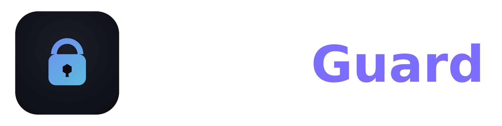

<p align="center">
  
</p>

<p align="center"><a href="../../README.md">English</a> · <b>Polski</b> · <a href="../de/README.md">Deutsch</a> · <a href="../es/README.md">Español</a> · <a href="../it/README.md">Italiano</a> · <a href="../uk/README.md">Українська</a></p>

<p align="center">
  <b>Offline’owy, szyfrowany end-to-end sejf na hasła, kody TOTP, notatki i pliki.</b><br>
  Bez konta. Bez chmury. Bez dostępu do sieci.
</p>

<p align="center">
  <a href="https://github.com/devsocha/SochaGuard/releases"></a>
  
  
</p>

> **Wersja przedpremierowa (0.x).** SochaGuard jest w trakcie rozwoju i nie przeszedł jeszcze niezależnego audytu bezpieczeństwa. Miej kopię zapasową ważnych danych.

## Funkcje

- **W pełni offline** – bez serwera, synchronizacji i analityki. Aplikacja nie potrzebuje połączenia z siecią.
- **Silne szyfrowanie** – wyprowadzanie klucza z Master Password przez Argon2id, uwierzytelnione szyfrowanie (XChaCha20-Poly1305 / AES-256-GCM) każdego zapisanego obiektu, także tytułów i adresów.
- **Hasła, TOTP, notatki i pliki** w jednym sejfie; obsługa wielu sejfów.
- **Klucz odzyskiwania** oraz szyfrowany eksport / import (import z KeePass `.kdbx`).
- **Android:** autouzupełnianie systemowe (z opcją „zaproponuj silne hasło” przy rejestracji), szybkie odblokowanie biometryczne.
- **Windows (portable):** globalny skrót **auto-type** `Ctrl + Shift + Spacja` wpisuje login i hasło do okna, w którym jesteś (bez schowka); działa w **zasobniku systemowym**, jedna instancja, opcjonalnie **uruchamianie z Windows**.
- Języki: English, Polski, Deutsch, Español, Italiano, Українська.

## Pobieranie

Najnowszą wersję pobierzesz ze strony [Releases](https://github.com/devsocha/SochaGuard/releases).

### Windows (portable)

1. Pobierz `SochaGuard_Windows_portable_v<version>.zip` oraz `SHA256SUMS_v<version>.txt`.
2. Sprawdź sumę kontrolną (PowerShell):
   ```powershell
   Get-FileHash .\SochaGuard_Windows_portable_v<version>.zip -Algorithm SHA256
   ```
   Wartość musi być taka sama jak w `SHA256SUMS_v<version>.txt`.
3. Rozpakuj archiwum w dowolnym miejscu (np. `C:\Tools\SochaGuard`) i uruchom `sochaguard.exe`. Nic się nie instaluje; sejf zostaje w Twoim profilu użytkownika.

> Windows SmartScreen może ostrzec o „nieznanym wydawcy” – wersje nie są jeszcze podpisane certyfikatem (zob. [ROADMAP](ROADMAP.md)). Sprawdzenie sumy SHA-256 potwierdza, że plik jest tym opublikowanym tutaj.

### Android

Plik APK pojawi się w wydaniach od etapu opisanego w [roadmapie](ROADMAP.md).

## Dokumentacja

[Pierwsze kroki](docs/GETTING_STARTED.md) · [FAQ](docs/FAQ.md) · [Model bezpieczeństwa](docs/SECURITY_MODEL.md) · [Ograniczenia](docs/LIMITATIONS.md) · [Prywatność](docs/PRIVACY.md)

## Bezpieczeństwo

Znalazłeś lukę? **Nie zgłaszaj** jej publicznie – zobacz [SECURITY](SECURITY.md).

Zobacz też: [CHANGELOG](../../CHANGELOG.md) · [ROADMAP](ROADMAP.md)

## Wersjonowanie

[Semantic Versioning](https://semver.org/). Dopóki wersja to `0.x`, format sejfu może się jeszcze zmieniać; każda taka zmiana jest opisana w [changelogu](../../CHANGELOG.md).

## Licencja

Zob. [LICENSE](../../LICENSE).
